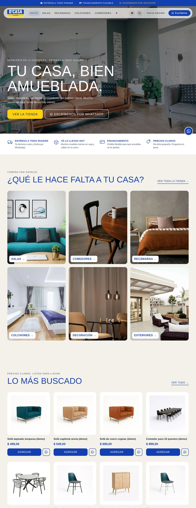
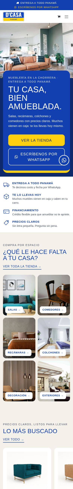
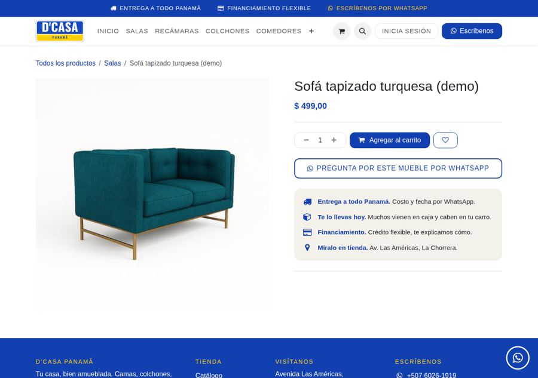
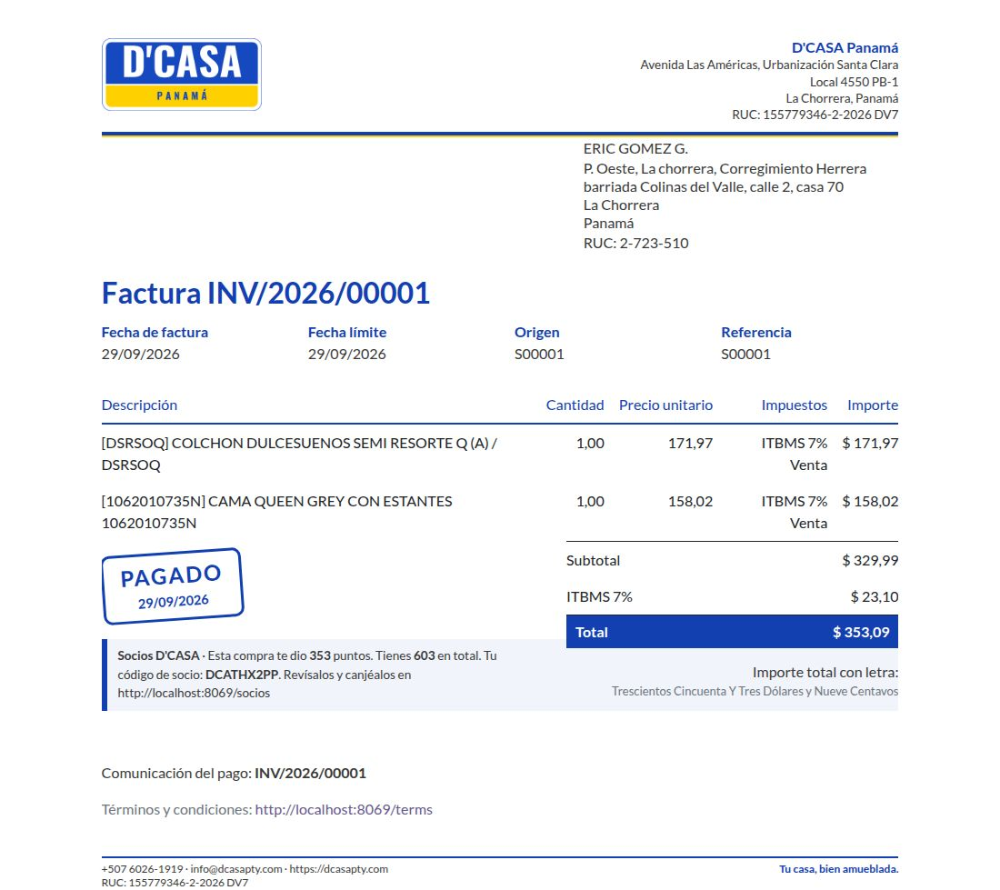
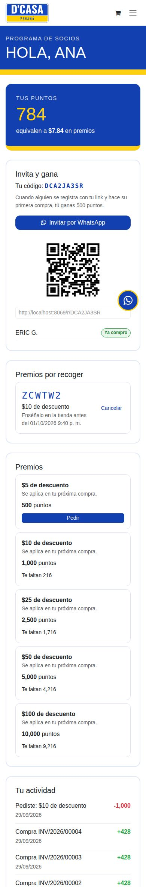

# D'CASA Panamá — ERP + sitio web (Odoo 19 en Cloudflare)

Plataforma única de **D'CASA Panamá** (mueblería en La Chorrera): facturación,
inventario, ventas, compras, CRM, clientes, **sitio web con tienda** y **programa
de puntos y referidos (Socios D'CASA)**, todo sobre el código abierto de **Odoo 19 Community**, con el
código fuente en este repositorio y desplegado en **Cloudflare**.

> Por qué: la tienda dependía de un programador externo y no tenía el código
> fuente. Aquí está todo: Odoo como submódulo (`vendor/odoo`) y las
> personalizaciones de D'CASA como módulos propios (`addons/`). Nunca se toca el
> código de Odoo; se extiende.

## Qué hay

| Carpeta | Qué es |
|---|---|
| `vendor/odoo` | Código fuente de Odoo 19.0 (submódulo git, fijado a un commit). |
| `addons/dcasa_base` | Empresa, Panamá (ITBMS 7 %, plan contable), RUC con DV, USD, apps del ERP. |
| `addons/dcasa_invoice` | Formato de factura D'CASA: marca, RUC+DV, sello **PAGADO**, monto en letras. |
| `addons/dcasa_socios` | Socios D'CASA: puntos automáticos al pagarse la factura, referidos, premios, canjes, cumpleaños y app del socio (celular + PIN) en `/socios`. Reglas de [DCasa-Referidos](https://github.com/abrinay1997-stack/DCasa-Referidos). |
| `addons/website_dcasa` | Sitio web y tienda con la marca, **mantenido desde el código** (el constructor de páginas de Odoo está apagado a propósito: [docs/OPERACION.md](docs/OPERACION.md) › «El sitio se edita por código»). |
| `addons/dcasa_interfaz` | La cara de Odoo por dentro: «Inicio» con el tablero del día, íconos propios, sin avisos de Enterprise (salen como «En desarrollo»), sin recorrido guiado, OdooBot ni datos de ejemplo. |
| `addons/dcasa_contabilidad` | Contabilidad a medida: estado de resultados, balance general, balance de comprobación, libro mayor, ITBMS y analítica (Excel y PDF); conciliación bancaria con importación de extractos CSV; presupuestos; cheques. Ver [docs/CONTABILIDAD.md](docs/CONTABILIDAD.md). |
| `addons/dcasa_nomina` | Nómina de Panamá: fichas de colaboradores, planilla quincenal (seguro social, seguro educativo, ISR), décimo tercer mes, vacaciones, prima, liquidación, reembolsos en nómina y asiento contable. Las tasas las valida el contador. Ver [docs/NOMINA.md](docs/NOMINA.md). |
| `addons/dcasa_contactos` | Una persona, una ficha: celular (con o sin +507), correo y RUC/cédula no se repiten; lista de posibles duplicados con fusión; el chat y la tienda reutilizan la ficha existente. Ver [docs/CONTACTOS.md](docs/CONTACTOS.md). |
| `addons/dcasa_equipo` | El equipo en Odoo: ícono de marca para Empleados. La pantalla de alta por texto se retiró a pedido de la dueña; el esquema de organización llegará después. Los datos de las personas viven solo en Odoo. Ver [docs/EQUIPO.md](docs/EQUIPO.md). |
| `addons/dcasa_barras` | Lector de códigos de barras (el de Odoo es Enterprise): Inventario › Escáner busca por código, referencia o empaque, muestra foto, precio «+ ITBMS» y existencias, Gerencia cuenta el inventario y asigna las etiquetas numeradas de un rollo a los productos (con historial); Inventario › Configuración › Códigos de barras llena los códigos desde la referencia (revisable y reversible). Ver [docs/BARRAS.md](docs/BARRAS.md). |
| `addons/dcasa_consolidacion` | Consolidación: estado de resultados, balance general y balance de comprobación de varias empresas del grupo en uno solo (columna por empresa, eliminaciones entre empresas y consolidado), con mapa de cuentas, advertencias de descuadre y PDF. Ver [docs/CONSOLIDACION.md](docs/CONSOLIDACION.md). |
| `addons/dcasa_brian` | **Brian**, el asistente de IA: chat en todas las pantallas (Ctrl + J), Telegram y servidor MCP con un solo catálogo de herramientas (ventas, catálogo, clientes, contabilidad, usuarios); lo sensible pide confirmación y lo prohibido no existe. Claude, ChatGPT, Grok o Llama. Ver [docs/BRIAN.md](docs/BRIAN.md). |
| `addons/dcasa_catalogo` | Catálogo real del Excel y las fotos (`fuentes/` y la bandeja `up media/`): el mismo producto en inventario, ventas y tienda web; stock ordenable para campañas. Ver [docs/CATALOGO.md](docs/CATALOGO.md). |
| `addons/dcasa_seguridad` | Acceso seguro al panel: doble factor (app de códigos y llaves de acceso), obligatoriedad por variable, bloqueo progresivo, registro y avisos de inicios de sesión, la puerta del equipo (Cloudflare Access), Turnstile y robots.txt para IA. Ver [docs/SEGURIDAD_ACCESO.md](docs/SEGURIDAD_ACCESO.md). |
| `addons/dcasa_conversaciones` | Bandeja de conversaciones con los clientes (WhatsApp, Telegram, Messenger, Instagram), CRM que se ajusta solo y la API que usa **Juan**. Ver [docs/JUAN_ODOO.md](docs/JUAN_ODOO.md) y [docs/CRM_AUTOMATICO.md](docs/CRM_AUTOMATICO.md). |
| `addons/dcasa_fe_pa` | Terreno listo para la factura electrónica de la DGI (documento rFE con CUFE, cola con reintentos, PAC simulado). **Apagado**: falta elegir el PAC. Ver [docs/FACTURA_ELECTRONICA.md](docs/FACTURA_ELECTRONICA.md). |
| `addons/dcasa_tienda_borde` | Avisa al Worker qué páginas del sitio cambiaron, para la caché del HTML de visitantes anónimos. |
| `addons/dcasa_adjuntos_r2` | Guarda las fotos y los PDF en R2 en vez de la base (el contenedor no tiene disco permanente). |
| `addons/dcasa_sesiones` | Sesiones de Odoo en PostgreSQL y la ruta de salud `/dcasa/salud`. |
| `edge/` | Worker de Cloudflare `dcasa` que sirve Odoo (caché, seguridad, puerta del equipo, cron). |
| `juan/` | Worker de Cloudflare de **Juan**, el asistente de los clientes (Durable Objects). Ver [docs/JUAN_WORKER.md](docs/JUAN_WORKER.md). |
| `puente-wa/` | Puente de WhatsApp por QR para Juan (Worker + Container). Ver [docs/JUAN_PUENTE.md](docs/JUAN_PUENTE.md). |
| `fuentes/` y `up media/` | Los originales de las fotos y Excel del catálogo (`fuentes/`, casi 1 GB) y la bandeja donde la dueña sube lo nuevo (`up media/`). Ver [docs/CATALOGO.md](docs/CATALOGO.md). |
| `docker/` | Imagen de producción (Odoo + módulos) y su arranque. |
| `scripts/` | `test.sh` instala los módulos en una base limpia y corre todos los tests; el resto: importar el catálogo, procesar `up media/`, respaldos y simulacro de restauración. |
| `docs/` | **[Índice de toda la documentación](docs/README.md)** · [Estado y prioridades](docs/ESTADO.md) · [Pendientes de la dueña](docs/PENDIENTES_DUENA.md) · [Plan](docs/PLAN.md) · [Arquitectura](docs/ARQUITECTURA.md) · [Despliegue](docs/DESPLIEGUE.md) · [Operación](docs/OPERACION.md) |

## Empezar (desarrollo local)

Opción A — todo en Docker:

```bash
git clone --recurse-submodules --shallow-submodules <este repo>
docker compose up --build          # http://localhost:8069  usuario admin / admin (solo local)
```

Opción B — Python local (más rápido para desarrollar):

```bash
make setup                         # submódulo + .venv con dependencias de Odoo
make init DB=dcasa                 # crea la base con los módulos y español
make run DB=dcasa                  # http://localhost:8069
make test                          # tests de todos los módulos (necesita PostgreSQL)
make edge-test                     # tests del Worker de Cloudflare
```

`scripts/test.sh` usa `DB_HOST/DB_USER/DB_PASSWORD` (por defecto `localhost/odoo/odoo`).

## Tests y despliegue

Cada push corre en GitHub Actions ([`.github/workflows/ci.yml`](.github/workflows/ci.yml)); el detalle de cada
job está en [docs/DESPLIEGUE.md](docs/DESPLIEGUE.md):

1. **Lint** (ruff, XML, shellcheck, actionlint).
2. **Tests de Odoo**: instala todos los módulos de `addons/` en una base PostgreSQL limpia y corre sus tests
   (incluidos los de navegador). La factura de prueba reproduce la factura real INV/2026/00821:
   $329,99 + ITBMS $23,10 = $353,09.
3. **Tests del borde, de Juan y del puente de WhatsApp**: typecheck + vitest de `edge/`, `juan/` y `puente-wa/`.
4. **Integración**: Odoo real y el Worker de Juan reales, hablándose por HTTP.
5. **Imagen Docker**: se construye una sola vez, se arranca contra una base vacía y se prueba (sitio, que no
   quede `admin/admin`, que el WAL llegue al almacenamiento de respaldos, factura en PDF).
6. **Simulacro de restauración**: mata PostgreSQL, borra el disco y restaura desde el respaldo.
7. **Despliegue** a Cloudflare: a **producción** solo con push a `main` y solo si todo lo anterior pasó; a
   **staging** a mano (*Actions → CI/CD → Run workflow*, `desplegar_en = staging`), desde cualquier rama.

Pasos para dejar Cloudflare listo: [docs/DESPLIEGUE.md](docs/DESPLIEGUE.md).

## Previsualizar la página (link en línea desde GitHub Actions)

- **En un PR:** ponle la etiqueta **`preview`**. El workflow *Previsualización* construye
  la imagen real, carga datos de demostración y abre un túnel de Cloudflare por
  60 minutos. El link aparece en el **resumen de la ejecución** y en el log del paso
  «Abrir el túnel».
- **A mano (cuando el workflow ya esté en `main`):** *Actions → Previsualización → Run
  workflow*, eligiendo los minutos.

Accesos de la demo: `/socios` con celular `6555-1234` y PIN `482915`; backend
`/web/login` con usuario `admin` y la clave aleatoria que muestra el resumen. La base de
prueba se borra al terminar. Sin la etiqueta, en cada PR solo se guardan capturas
(artefacto **capturas-del-sitio**).

## Cómo se cambia el sitio

El texto, las secciones y el diseño del sitio **se cambian desde el repositorio** (`addons/website_dcasa`) y llegan
con cada despliegue; el constructor visual de Odoo («Sitio web → Editar») está apagado a propósito, porque guardar una
página con él hace una copia que deja de recibir los cambios del código
([docs/OPERACION.md](docs/OPERACION.md) › «El sitio se edita por código»). Lo del día a día sí se hace en el panel:
publicar o despublicar productos, fotos, descripciones y categorías (**Inventario / Ventas → Productos**, casilla
*Publicado*) y el número de WhatsApp de todos los botones (**Sitio web → Configuración → Ajustes**).

## Capturas (base de demostración)

| Inicio | Inicio (móvil) | Ficha de producto |
|---|---|---|
|  |  |  |

| Factura con puntos | App del socio (móvil) |
|---|---|
|  |  |

Diseño del sitio, mapa de calor, accesibilidad y SEO: [docs/REDISENO.md](docs/REDISENO.md).
Las fotos de ambiente son del tema Loftspace de Odoo (LGPL-3) hasta tener la sesión de fotos
propia; los productos «(demo)» solo existen en la base de previsualización.

> Las fuentes de marca (Anton/Oswald) se cargan desde Google Fonts en producción;
> en las capturas se ve la tipografía de respaldo.
