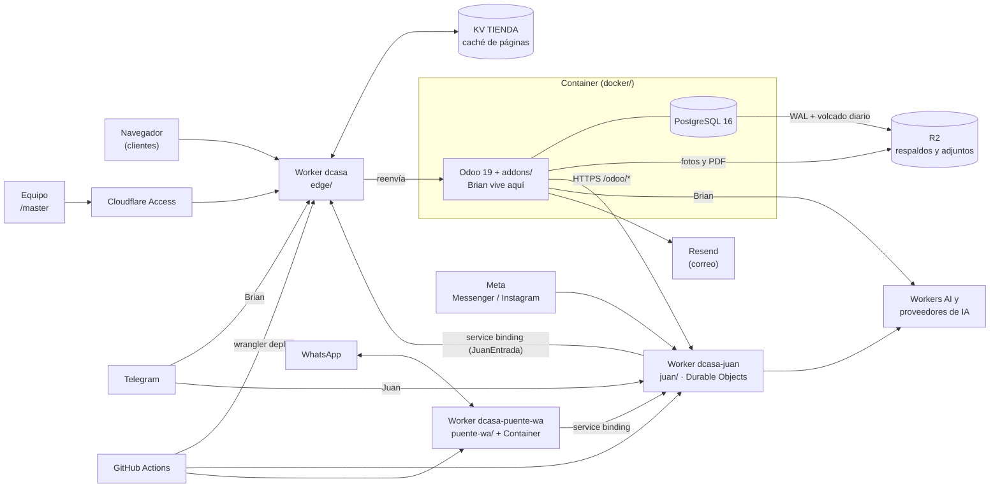

# D'CASA Panamá — ERP + sitio web (Odoo 19 en Cloudflare)

> **¿Te pasaron este link para instalar el sistema en otro negocio?** Sigue [docs/REPLICAR.md](docs/REPLICAR.md) de
> principio a fin. Antes de tocar nada, lee [`CLAUDE.md`](CLAUDE.md) (las reglas del repositorio).

## Qué es

Una sola plataforma para una tienda de muebles en Panamá: facturación, inventario, ventas, compras, CRM, contabilidad,
nómina, **sitio web con tienda**, **programa de puntos y referidos (Socios)** y programa de vendedores, más dos
asistentes de IA: **Brian** (para el equipo, dentro del panel) y **Juan** (para los clientes, por WhatsApp, Telegram,
Messenger e Instagram). Está hecho sobre el código abierto de **Odoo 19 Community** y corre en **Cloudflare** (Workers,
Containers, Durable Objects, R2 y KV).

- Odoo viene como submódulo (`vendor/odoo`) y **no se modifica nunca**; todo lo propio está en módulos de `addons/`.
- Odoo y PostgreSQL corren en **un** contenedor; la base se respalda sin parar en R2 y se restaura sola al arrancar.
- Todo cambio pasa por pruebas en GitHub Actions; a producción solo se llega a mano, desde `main`.

## Cómo se conecta todo



| Pieza | Qué hace |
|---|---|
| **Worker `dcasa`** (`edge/`) | La puerta de entrada: seguridad, bloqueo de rutas peligrosas, caché de páginas anónimas en KV, la puerta del equipo con Cloudflare Access, respaldo a mano y dos crons (despertar a Odoo y respaldo diario). |
| **Contenedor de Odoo** (`docker/`) | Odoo 19, los módulos de `addons/` y PostgreSQL 16. Restaura la base desde R2 al arrancar y actualiza los módulos si cambió el código. Una sola instancia. |
| **R2** | Un bucket por entorno: WAL y respaldos cifrados, volcado diario, fotos y PDF. |
| **Worker `dcasa-juan`** (`juan/`) | Juan, el asistente de los clientes. Un Durable Object por conversación (memoria de trabajo en SQLite); lo permanente se guarda en Odoo. |
| **Worker `dcasa-puente-wa`** (`puente-wa/`) | Mantiene WhatsApp conectado por QR (Baileys) para Juan. Aún no desplegado. |
| **GitHub Actions** (`.github/`) | Pruebas en cada cambio; despliegue a staging y a producción solo a mano. |

Detalle de cada recurso, tablas, variables y secretos: [docs/ARQUITECTURA.md](docs/ARQUITECTURA.md).

## Carpetas

| Carpeta | Qué hay |
|---|---|
| `vendor/odoo` | Odoo 19.0 (submódulo git fijado a un commit). **No se modifica nunca.** |
| `addons/` | Los 24 módulos propios (prefijo `dcasa_` y `website_dcasa`). Uno por uno: [docs/MODULOS.md](docs/MODULOS.md). |
| `edge/` | Worker de Cloudflare `dcasa` (TypeScript). Lógica probada en `src/routing.ts` y `src/handler.ts`. Contrato con la imagen: [`edge/CONTRATO_CONTENEDOR.md`](edge/CONTRATO_CONTENEDOR.md). |
| `juan/` | Worker de Juan (TypeScript, Durable Objects). [docs/JUAN_WORKER.md](docs/JUAN_WORKER.md). |
| `puente-wa/` | Puente de WhatsApp por QR (Worker + Durable Object + Container). [docs/JUAN_PUENTE.md](docs/JUAN_PUENTE.md). |
| `docker/` | Imagen de producción (`Dockerfile`), arranque (`entrypoint.sh`) y PostgreSQL con pgBackRest (`pg.sh`). |
| `scripts/` | `test.sh` (instala en base limpia y corre las pruebas), respaldo, simulacro de restauración, importar el catálogo, procesar `up media/`, integración de Juan. |
| `.github/` | Flujos de CI y despliegue, sus scripts y las versiones estables. |
| `fuentes/` y `up media/` | Originales del catálogo (casi 1 GB) y la bandeja donde la dueña sube fotos y Excel. [docs/CATALOGO.md](docs/CATALOGO.md). |
| `docs/` | Toda la documentación. **[Índice](docs/README.md)**. |

## Comandos

```bash
# Clonar con el submódulo de Odoo
git clone --recurse-submodules --shallow-submodules https://github.com/dcasapty/D_Casa_new_word.git

# Odoo en local (Python)
make setup                  # submódulo + .venv con las dependencias de Odoo
make init DB=dcasa          # crea la base con los módulos y español
make run DB=dcasa           # http://localhost:8069
make update DB=dcasa        # actualiza los módulos en esa base

# Todo en Docker
docker compose up --build   # http://localhost:8069 (admin / admin, solo local)

# Pruebas
scripts/test.sh [modulo1,modulo2]   # instala en base limpia y corre los tests (PostgreSQL: DB_HOST/DB_USER/DB_PASSWORD)
ruff check addons
cd edge && npm ci && npm test && npm run typecheck     # igual en juan/ y puente-wa/
```

`make init` instala casi todos los módulos; el contenedor instala la lista `ODOO_MODULES` de `docker/entrypoint.sh`
(todos menos `dcasa_fe_pa`). Detalle en [docs/MODULOS.md](docs/MODULOS.md).

## Despliegue, en corto

- **CI/CD** (`ci.yml`) corre en cada PR y cada push a `main`: lint, pruebas de Odoo, de los tres Workers, integración,
  imagen Docker probada y simulacro de restauración. Un push a `main` **nunca** despliega.
- **Staging:** *Actions › CI/CD › Run workflow*, `desplegar_en = staging`, desde cualquier rama.
- **Producción:** *Actions › Desplegar* en `main` con el `imagen_digest` y el `app_version` probados en staging.
- **Juan y el puente:** sus flujos propios (*Desplegar Juan*, *Desplegar puente de WhatsApp*), siempre a mano.
- **Volver atrás:** *Volver a una versión estable* o *Desplegar* con una versión anterior, restaurando antes la base.

Receta completa y flujos: [docs/ARQUITECTURA.md §6](docs/ARQUITECTURA.md) · [docs/DESPLIEGUE.md](docs/DESPLIEGUE.md) ·
[docs/OPERACION.md](docs/OPERACION.md). Antes de desplegar, leer [docs/CONTEXTO_AGENTICO.md](docs/CONTEXTO_AGENTICO.md).

## Documentos

| Para… | Leer |
|---|---|
| Instalar el sistema para otro negocio | [docs/REPLICAR.md](docs/REPLICAR.md) |
| Las reglas del repositorio (marca, Socios, Vendedores, convenciones de Odoo 19) | [CLAUDE.md](CLAUDE.md) |
| Retomar el trabajo (cómo se trabaja con la dueña, bitácora) | [docs/LEEME_PRIMERO.md](docs/LEEME_PRIMERO.md) · [docs/PRIORIDADES.md](docs/PRIORIDADES.md) |
| Cómo se conecta todo: Cloudflare, tablas, configuración, despliegue | [docs/ARQUITECTURA.md](docs/ARQUITECTURA.md) |
| Qué hace cada módulo | [docs/MODULOS.md](docs/MODULOS.md) |
| Roles, permisos, interruptores, privacidad y políticas del sitio | [docs/PERMISOS.md](docs/PERMISOS.md) |
| Desplegar y volver atrás | [docs/DESPLIEGUE.md](docs/DESPLIEGUE.md) · [docs/VERSIONES_ESTABLES.md](docs/VERSIONES_ESTABLES.md) |
| Operar: costos, respaldos, si el sitio se cae, subir fotos | [docs/OPERACION.md](docs/OPERACION.md) |
| Incidentes y trampas ya conocidas | [docs/CONTEXTO_AGENTICO.md](docs/CONTEXTO_AGENTICO.md) |
| Seguridad de acceso (doble factor, puerta del equipo) | [docs/SEGURIDAD_ACCESO.md](docs/SEGURIDAD_ACCESO.md) |
| Socios, Mi cuenta y vendedores | [docs/SOCIOS.md](docs/SOCIOS.md) · [docs/VENDEDORES.md](docs/VENDEDORES.md) |
| Juan y Brian | [docs/JUAN.md](docs/JUAN.md) · [docs/JUAN_WORKER.md](docs/JUAN_WORKER.md) · [docs/JUAN_ODOO.md](docs/JUAN_ODOO.md) · [docs/JUAN_PUENTE.md](docs/JUAN_PUENTE.md) · [docs/BRIAN.md](docs/BRIAN.md) |
| Todo lo demás | [docs/README.md](docs/README.md) (índice) |

## El sitio se cambia desde el código

Textos, secciones y diseño del sitio viven en `addons/website_dcasa` y llegan con cada despliegue; el constructor visual
de Odoo está apagado a propósito ([docs/OPERACION.md › El sitio se edita por código](docs/OPERACION.md)). Lo del día a
día sí se hace en el panel: publicar productos, fotos, descripciones y categorías, y el número de WhatsApp de todos los
botones (*Sitio web › Configuración › Ajustes*).

## Capturas (base de demostración)

| Inicio | Inicio (móvil) | Ficha de producto |
|---|---|---|
|  |  |  |

| Factura con puntos | App del socio (móvil) |
|---|---|
|  |  |

Diseño del sitio: [docs/REDISENO.md](docs/REDISENO.md). Para ver el sitio con datos de demostración sin tocar ningún
entorno: *Actions › Previsualización › Run workflow* (túnel temporal de hasta 60 minutos).

## Licencia

Odoo Community y los módulos de `addons/` son LGPL-3 (ver cada `__manifest__.py`).
