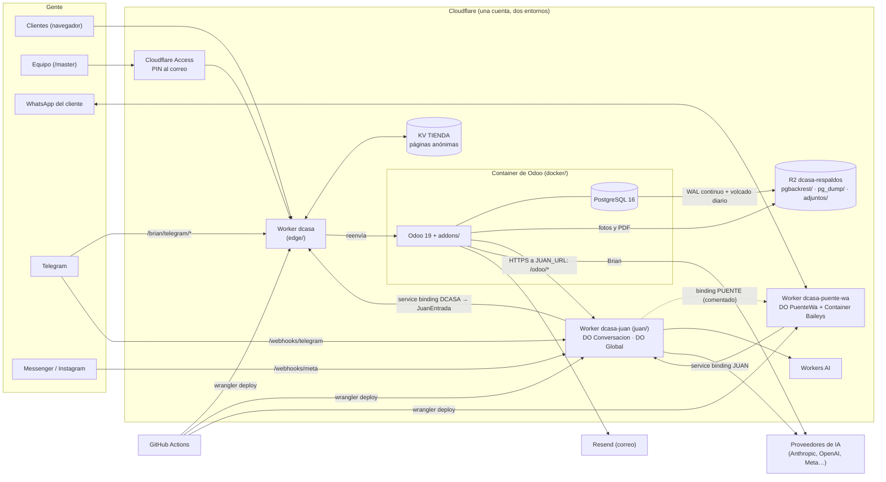

# Arquitectura

Cómo está armado el sistema, pieza por pieza: lo que hay en Cloudflare, las tablas que guarda cada pieza, dónde vive la
base de Odoo, qué variables y secretos usa cada entorno y cómo se despliega. Puesto al día el **2026-10-18** contra
`edge/wrangler.jsonc`, `juan/wrangler.jsonc`, `puente-wa/wrangler.jsonc`, `.github/workflows/`, `docker/` y el código de
los tres Workers. Los nombres de los recursos de la cuenta se confirmaron ese día con una consulta de **solo lectura** a
Cloudflare (sin IDs aquí).

Por qué es así (y no una base gestionada aparte): la opción con PostgreSQL en Neon se descartó por costo; la base vive
**dentro del contenedor**, protegida por respaldos continuos en R2. Decisión y mediciones:
[auditoria/DECISION_Y_PLAN.md](auditoria/DECISION_Y_PLAN.md). Contrato entre el Worker y la imagen:
[`edge/CONTRATO_CONTENEDOR.md`](../edge/CONTRATO_CONTENEDOR.md). Módulos de Odoo: [MODULOS.md](MODULOS.md).

## 1. El dibujo

En palabras: todo el tráfico del sitio entra por el Worker **`dcasa`**, que pone seguridad y caché y reenvía al
**contenedor**, donde viven Odoo y PostgreSQL juntos. La base se respalda sin parar en **R2**. **Juan** (el asistente de
los clientes) es otro Worker con su memoria de trabajo en Durable Objects; llega a Odoo solo por el *service binding*
del borde (`/dcasa/juan/v1/*`). El **puente de WhatsApp** es un tercer Worker con su propio contenedor; en este commit
**no está desplegado** (§2.1) y el binding de Juan hacia él está comentado. **Brian** (el asistente del panel) vive
dentro de Odoo.

## 2. Las piezas de Cloudflare

### 2.1 Workers

| Worker (producción · staging) | Carpeta | Entrada | Qué hace | ¿Existe en la cuenta? (2026-10-18) |
|---|---|---|---|---|
| `dcasa` · `dcasa-staging` | `edge/` | `src/index.ts` | Punto de entrada público: cabeceras de seguridad, rutas bloqueadas, frena bots y limita intentos (`bots.ts`), puerta del equipo (`puerta.ts`), página «estamos abriendo» (`arranque.ts`), caché de páginas anónimas (`tienda/`), respaldo a mano y crons. La lógica probada está en `src/routing.ts` y `src/handler.ts`, sin dependencias de Cloudflare. | Sí, los dos |
| `dcasa-juan` · `dcasa-juan-staging` | `juan/` | `src/index.ts` | Juan: junta ráfagas de mensajes, corre el bucle de IA con herramientas de Odoo, contesta y hace seguimiento. `workers_dev: true` (Odoo lo llama por esa dirección). | Sí, los dos |
| `dcasa-puente-wa` · `dcasa-puente-wa-staging` | `puente-wa/` | `src/worker.ts` | Mantiene la sesión de WhatsApp por QR (Baileys) las 24 horas. Aparte de Juan a propósito: si el puente falla, Juan sigue por los demás canales. | **No** (todavía no se desplegó) |

`compatibility_date` `2026-09-01` en los tres; `nodejs_compat` en `juan/` y `puente-wa/`; `observability` encendida.
Wrangler fijado por los `package-lock.json` (4.143.0 en este commit).

**Dominio y rutas.** Las `routes` de `edge/wrangler.jsonc` (líneas 109-112 y 173) están **comentadas** hasta que el DNS
del dominio esté en Cloudflare ([DESPLIEGUE.md §6](DESPLIEGUE.md)). Mientras tanto cada Worker responde en su dirección
`<worker>.<subdominio>.workers.dev`.

**Crons** (UTC):

| Worker | Cron | Qué hace |
|---|---|---|
| `dcasa` | `7 * * * *` | Si el contenedor está apagado y el entorno es 24/7, lo enciende; si está encendido no hace nada. |
| `dcasa` | `17 8 * * *` (03:17 Panamá) | Respaldo lógico diario dentro del contenedor (`/usr/local/bin/dcasa-respaldo`). No enciende a Odoo si está apagado. |
| `dcasa-juan` | `23 * * * *` | ¿Sigue conectado el puente? ¿Se llegó al tope de IA? Avisa por Telegram si hay chat configurado. |
| `dcasa-puente-wa` | `* * * * *` | Supervisor fuera del Durable Object: reanuda la vigilancia de la conexión de WhatsApp. |

Los dos de `dcasa` tienen que coincidir con `CRON_HORARIO` y `CRON_RESPALDO` de `edge/src/handler.ts` (hay prueba).

**Bindings:**

| Worker | Binding | Tipo | Apunta a |
|---|---|---|---|
| `dcasa` | `ODOO` | Durable Object | clase `OdooContainer` (el contenedor de Odoo) |
| `dcasa` | `TIENDA` | KV | caché de páginas (namespace que crea wrangler) |
| `dcasa` | `LIMITE_ACCESO`, `LIMITE_FORMULARIOS`, `LIMITE_CARRITO` | Rate Limiting | **comentados**: sin ellos el Worker usa un contador en memoria |
| `dcasa-juan` | `CONVERSACION`, `GLOBAL` | Durable Objects | clases `Conversacion` y `Global` |
| `dcasa-juan` | `AI` | Workers AI | notas de voz, lectura de imágenes y, si Gerencia lo enciende, búsqueda por significado |
| `dcasa-juan` | `DCASA` | Service binding | Worker `dcasa` (staging: `dcasa-staging`), *entrypoint* `JuanEntrada` |
| `dcasa-juan` | `PUENTE` | Service binding | **comentado** (`juan/wrangler.jsonc` líneas 33 y 75): se descomenta cuando el puente exista |
| `dcasa-puente-wa` | `WA` | Durable Object | clase `PuenteWa` |
| `dcasa-puente-wa` | `JUAN` | Service binding | Worker `dcasa-juan` (staging: `dcasa-juan-staging`) |
| `dcasa-puente-wa` | `COPIAS` | R2 | **comentado** (copia diaria opcional de la sesión, `COPIA_R2 = off`) |

Worker a Worker **siempre por service binding**: Cloudflare rechaza la URL pública entre Workers de la misma cuenta
(error 1042) y no despliega un Worker que declara un binding a otro que todavía no existe. Orden obligado: `dcasa` →
`dcasa-juan` → `dcasa-puente-wa`.

### 2.2 Containers

| App | Clase | Imagen | Tamaño | Instancias | Región | Política |
|---|---|---|---|---|---|---|
| Odoo, producción | `OdooContainer` | `docker/Dockerfile`; al desplegar, la imagen ya probada del registro de Cloudflare (`dcasa-odoo:<SHA>`) | `standard-1` (½ vCPU, 4 GiB) | 1 | `ENAM` | `default` |
| Odoo, staging | `OdooContainer` | ídem | `basic` | 1 | `ENAM` | `default` |
| Puente (los dos entornos) | `PuenteWa` | `puente-wa/contenedor/Dockerfile` (wrangler la construye al desplegar) | `lite` | 1 | — | `default` |

- **Una sola instancia** a propósito: dos PostgreSQL escribiendo al mismo repositorio de R2 serían dos contabilidades;
  dos conexiones de WhatsApp al mismo número se expulsan entre sí.
- La política `default` es **inmutable**: cambiarla exige otra app y otra clase ([CONTRATO §4](../edge/CONTRATO_CONTENEDOR.md)).
- **Producción y staging 24/7:** `ODOO_DORMIR_TRAS` está vacío en los dos entornos de `edge/wrangler.jsonc` (líneas 70 y
  153). Con una duración (`"1h"`) el contenedor duerme sin visitas y restaura desde R2 al despertar. (Documentos viejos
  dicen que staging duerme tras 1 h: manda el archivo.)

### 2.3 Durable Objects

| Worker | Clase | Instancias | Almacenamiento |
|---|---|---|---|
| `dcasa` | `OdooContainer` | una sola, nombre `odoo-main` | SQLite del DO (migración `v1`) usado como llave-valor: `ultimoRearranque`, `ultimaAlerta`. No guarda datos del negocio. |
| `dcasa-juan` | `Conversacion` | una por conversación, nombre `<canal>:<id_externo>` | SQLite propio: memoria de trabajo de esa conversación (§3.1). |
| `dcasa-juan` | `Global` | una sola, nombre `juan` | SQLite propio: gasto de IA y salud (§3.2). |
| `dcasa-puente-wa` | `PuenteWa` | una sola, nombre `unico` | SQLite propio: la sesión de WhatsApp **cifrada** y los topes de envío (§3.3); además `epoca`, `huellaToken` y `diario` como llave-valor. |

### 2.4 KV namespaces

| Binding | Namespace en la cuenta | Quién lo crea | Qué guarda |
|---|---|---|---|
| `TIENDA` (producción) | `dcasa-tienda` | **wrangler, en el primer despliegue** (el binding no lleva `id`: aprovisionamiento automático; el token necesita «Workers KV Storage: Edit») | `html:<host><ruta>` (página de Odoo para anónimos), `asset:<ruta?query>` (estilos, JS, fuentes, fotos) e `invalidado` (hora de la última invalidación). Páginas: caducan a los 7 días sin uso; assets: 30. |
| `TIENDA` (staging) | `dcasa-staging-tienda` | ídem | ídem |

La caché se sirve solo con `TIENDA_ESTATICA = on` (en este commit: `off` en producción, `on` en staging). Rutas que se
pueden guardar: portada, `/shop` y sus páginas, categorías y fichas con `-<id>`, `/visitanos`, `/privacidad`,
`/terminos`, `/black-weekend` (`RUTAS_ESTATICAS` en `edge/src/routing.ts`). Todo lo demás va siempre a Odoo.

### 2.5 R2 buckets

| Bucket | Entorno | Quién lo crea | Prefijos |
|---|---|---|---|
| `dcasa-respaldos` | producción | **a mano** (panel de R2, ubicación ENAM) | `pgbackrest/` (WAL y respaldos físicos cifrados), `pg_dump/` (volcado lógico diario cifrado, 30 días), `anual/` (el primer volcado de cada año, no se poda), `adjuntos/` (fotos y PDF de Odoo), opcional `fuentes/` (originales del catálogo, `scripts/archivar_fuentes.sh`) |
| `dcasa-respaldos-staging` | staging | ídem | ídem |

Odoo y pgBackRest entran a R2 por la **API S3** con un token de R2 limitado a ese bucket; por eso el Worker no tiene
binding de R2. **Nunca** se comparte un bucket entre entornos. El bucket opcional del puente no existe (binding comentado).

### 2.6 D1

**No hay ninguna base D1** (confirmado en la cuenta el 2026-10-18). Juan y el puente guardan en el SQLite de sus Durable
Objects.

### 2.7 Lo que se configura en el panel de Cloudflare (no está en el código)

- **Cloudflare Access** (Zero Trust): una aplicación por entorno sobre la ruta de la puerta (`/master*`), con PIN al
  correo ([SEGURIDAD_ACCESO.md §8](SEGURIDAD_ACCESO.md)).
- **Turnstile**: un widget; clave pública en `TURNSTILE_SITE_KEY` y secreta en `TURNSTILE_SECRET`.
- **Registro de imágenes**: `wrangler containers push` sube la imagen de Odoo como `dcasa-odoo:<SHA del commit>`.
- **Alertas de presupuesto y reglas de ciclo de vida de R2**: [OPERACION.md › Barandas de costo](OPERACION.md).

### 2.8 Rutas del borde

| Ruta | Qué pasa |
|---|---|
| `GET /__edge/health` | Estado sin despertar a Odoo. 200 solo si `/dcasa/salud` dio 2xx; con la imagen de producción trae `version`, `base_al_dia` y `humo`. |
| `POST /__edge/respaldo` + `Authorization: Bearer <RESPALDO_TOKEN>` | Respaldo a mano (lo usa el despliegue antes de cada versión). 404 si el token falta o es corto. |
| `POST /__edge/tienda/regenerar` + `Bearer <TIENDA_FEED_TOKEN>` | Odoo avisa qué páginas cambiaron. |
| Otras `/__edge/*` | 404; nunca llegan a Odoo. |
| `/web/database/*`, `/jsonrpc`, `/xmlrpc*`, `/json/2*`, `/doc-bearer*`, `/dcasa/juan/*` | 404 desde internet (`BLOCKED_PREFIXES`, sobre la ruta normalizada). `/dcasa/juan/*` solo entra por el service binding. |
| `/brian/*` | Pasa a Odoo y nunca se guarda en caché. |
| `www.<dominio>` | 301 (GET) o 308 (POST) al dominio canónico. |
| Ruta de la puerta (`DCASA_PUERTA_RUTA`) | Verifica el pase de Cloudflare Access y abre la puerta del equipo. |

Juan: `/health`, `/salud` (público, solo nombres y estados), `/webhooks/telegram`, `/webhooks/meta`,
`/webhooks/whatsapp-qr`, `/webhooks/whatsapp-cloud`, `/media/...` (firmado) y `/odoo/*` (con `JUAN_WORKER_TOKEN`).
Puente: `/health`, `/api/*` (con token) y `/puente/*` (su contenedor). Detalle: [JUAN_WORKER.md](JUAN_WORKER.md) y
[JUAN_PUENTE.md](JUAN_PUENTE.md) (apéndice A).

## 3. Tablas

De los `CREATE TABLE` del código. Son memoria de trabajo: **lo permanente vive en Odoo**.

### 3.1 Juan · `Conversacion` — `juan/src/motor/almacen.ts`

| Tabla | Columnas | Para qué |
|---|---|---|
| `kv` | `k` (PK), `v` | Valores sueltos de la conversación: identidad, estado, pausas, contadores. |
| `mensajes` | `id` (PK), `id_mensaje` (único), `rol` (`cliente`/`bot`/`vendedora`), `texto`, `adjuntos`, `ts`, `pendiente`, `modelo` · índice `mensajes_ts` | Últimos mensajes y la ráfaga pendiente. |
| `cola` | `id` (PK), `tipo`, `cuerpo`, `intentos`, `proximo`, `creado` | Escrituras a Odoo por reintentar. |
| `medios` | `id` + `parte` (PK), `mime`, `nombre`, `datos` (BLOB), `creado` | Archivos temporales del cliente, en partes. |
| `fotos` | `codigo` (PK), `url`, `nombre`, `ts` | Fotos de productos ya resueltas por código. |
| `enviados` | `id` (PK), `ts` | Lo que ya se mandó (no repetir). |
| `seguimientos` | `clave` (PK), `ts` | Seguimientos ya hechos. |

### 3.2 Juan · `Global` — `juan/src/motor/global.ts`

| Tabla | Columnas | Para qué |
|---|---|---|
| `gasto` | `mes` + `modelo` (PK), `entrada`, `cache_lectura`, `cache_escritura`, `salida`, `usd`, `turnos`, `estimado` | Tokens y costo de IA por mes y modelo (el tope mensual). |
| `gasto_dia` | `dia` (PK), `usd`, `turnos` | Gasto de cada día (gráfica de Costos de IA). |
| `salud` | `clave` (PK), `valor`, `ts` | Último estado de salud. |

### 3.3 Puente · `PuenteWa` — `puente-wa/src/almacen.ts`

| Tabla | Columnas | Para qué |
|---|---|---|
| `wa_auth` | `clave` (PK), `valor` (cifrado), `actualizado_en` | La sesión de Baileys, **cifrada** con `WA_SESION_CLAVE`. |
| `wa_copias` | `copia` + `clave` (PK), `valor`, `actualizado_en` | Copias diarias de la sesión (se guardan 7). |
| `wa_copias_meta` | `copia` (PK), `creada_en`, `filas` | Índice de las copias. |
| `wa_envios` | `id` (PK), `ts`, `para`, `frio` | Cada burbuja enviada: topes por minuto, día y destinatario. |
| `wa_enviados` | `id` (PK), `ts` | Ids de lo que mandó el puente (no confundir su eco). |
| `wa_contactos` | `celular` (PK), `ultimo_entrante` | Cuándo escribió cada cliente (¿envío «en frío»?). |
| `wa_pendientes` | `id` (PK), `creado_en`, `intentos`, `cuerpo` | Entrantes que Juan no pudo recibir (se reintentan hasta 48 h). |

### 3.4 Lo que guarda Odoo

Todo lo permanente: facturas, inventario, clientes, conversaciones, oportunidades, catálogo y los libros de Socios y
vendedores (modelos por módulo en [MODULOS.md](MODULOS.md)). Tablas que conviene conocer: `dcasa_http_session`
(sesiones HTTP) e `ir_config_parameter` con los marcadores del arranque (`dcasa.deployed_version`,
`dcasa.codigo_desplegado`, `dcasa.codigo_orden`, `dcasa.admin_saneado`, `dcasa.sobrantes_version`).

## 4. La base de Odoo

- **Dónde vive:** PostgreSQL 16 **dentro del mismo contenedor** que Odoo (`/var/lib/odoo/pg`, solo socket local, base
  `dcasa`). El disco del contenedor es **efímero**.
- **Cómo se respalda** (`docker/pg.sh`, `scripts/respaldo.sh`): pgBackRest manda cada segmento de WAL a `pgbackrest/`
  (`archive_timeout` 60 s: se acepta perder ≈ 1 minuto), completo cada 24 h e incremental cada 6 h, 7 días; volcado
  lógico cifrado diario a `pg_dump/` (30 días; el primero de cada año a `anual/`); y un respaldo completo antes de cada
  despliegue (`POST /__edge/respaldo`; si falla, no se despliega). Todo cifrado con `PGBACKREST_CIPHER_PASS`
  (**nunca se rota**).
- **Cómo se restaura:** cada arranque restaura el último respaldo + WAL desde R2 **antes** de abrir el puerto; con R2
  vacío crea una base nueva; si la restauración falla, sale con error y nunca crea una base vacía encima. A un momento
  anterior: `DCASA_RESTAURAR_HASTA` ([OPERACION.md › Restaurar a un punto en el tiempo](OPERACION.md)).
- **Simulacro:** cada corrida de CI ejecuta `scripts/simulacro_restauracion.sh` (mata PostgreSQL, borra el disco,
  restaura desde un S3 local y compara; falla si se pierden más de 90 s o hay filas distintas). Con R2 de verdad:
  [OPERACION.md › Simulacro mensual de restauración](OPERACION.md).
- **Adjuntos** en `adjuntos/` del mismo bucket; un respaldo sin ese prefijo no restaura los archivos. **Sesiones** en la
  base (sobreviven a reinicios).

**Cada arranque** (`docker/entrypoint.sh`): restaura o crea la base → genera `odoo.conf` desde variables → base nueva:
instala `ODOO_MODULES` (línea 176) en `es_419`; base con **otra huella de código** que la imagen (`/opt/dcasa/CODIGO`):
`odoo -u` (una imagen más vieja que la base no la toca; emergencia `DCASA_PERMITIR_BAJAR`) → adjuntos a R2, saneo de
`admin` (si sigue con clave `admin`, pasa a `ADMIN_PASSWORD`), `web.base.url = https://CANONICAL_HOST` → desinstala los
módulos que no se usan → prueba de humo (`DCASA_HUMO=0` la apaga) → arranca Odoo (`db_maxconn` 48, un hilo de cron).

**Acciones planificadas de Odoo** (por módulo, en [MODULOS.md](MODULOS.md)): adjuntos (30 min y diario), vigilancia de
disco/memoria/base (1 h), depuración y reporte (mensual), Juan y CRM (5-15 min, diarios), correo (10-15 min), bono por
meta (diario), accesos (semanal), canjes (1 h), tienda del borde (15 min y 1 h), apartados (diario).

## 5. Configuración por entorno

Cuatro lugares. Ningún valor secreto está en el repositorio.

| Dónde | Qué va ahí | Cómo llega |
|---|---|---|
| **GitHub › Settings › Environments** (`staging`, `production`) | Secretos y variables del Worker `dcasa` y del contenedor | `desplegar.yml` los valida y los sube con `wrangler deploy --secrets-file` |
| **`edge/wrangler.jsonc`** (`vars`, una sección por entorno) | Variables no secretas del borde y del contenedor | Con cada despliegue |
| **Panel de Cloudflare** (Worker › Settings › Variables and Secrets) | Secretos de Juan y del puente, y lo que se cambia a mano (`JUAN_URL`, chats de alerta…) | Se pegan a mano; los despliegues usan `--keep-vars` y no los borran |
| **Odoo** (Ajustes) | WhatsApp, textos de documentos, tope de descuento, ajustes de Juan y Brian | Base de datos |

### 5.1 GitHub Environments (`staging` y `production`, cada uno con valores propios)

`.github/scripts/validar_entorno.sh` exige los obligatorios antes de tocar Cloudflare (no vacíos, sin marcadores como
`CAMBIAR` o `<...>`, ≥ 32 caracteres donde se indica, maestra distinta de la de `admin`). Si un environment no tiene
**ninguno** de los secretos de despliegue, el despliegue se omite con un aviso.

| Tipo | Nombre | Oblig. | Para qué |
|---|---|---|---|
| Secret | `CLOUDFLARE_API_TOKEN` | sí | Token de cuenta para desplegar (permisos en [REPLICAR.md §5](REPLICAR.md)) |
| Secret | `CLOUDFLARE_ACCOUNT_ID` | sí | Cuenta de Cloudflare (también arma `R2_ENDPOINT`) |
| Secret | `R2_ACCESS_KEY_ID`, `R2_SECRET_ACCESS_KEY` | sí | Token de R2 del bucket de ese entorno |
| Secret | **`PGBACKREST_CIPHER_PASS`** | sí (≥ 32) | Cifra los respaldos. **Nunca se rota.** Se sube al Worker solo si todavía no lo tiene |
| Secret | `RESPALDO_TOKEN` | sí (≥ 32) | Autoriza `POST /__edge/respaldo` |
| Secret | `ODOO_ADMIN_PASSWORD` | sí | Clave del usuario `admin` (en el Worker: `ADMIN_PASSWORD`) |
| Secret | `ODOO_MASTER_PASSWORD` | sí | Contraseña maestra de Odoo, distinta de la de `admin` |
| Secret | **`DCASA_PIN_PEPPER`** | sí (≥ 32) | Pimienta del PIN de los socios. **Nunca se rota.** Se sube solo si el Worker no la tiene |
| Secret | `BRIAN_API_KEY` | sí | Clave del proveedor de IA de Brian |
| Secret | `RESEND_API_KEY` | no | Correo a clientes ([CORREO.md](CORREO.md)) |
| Secret | `TELEGRAM_BOT_TOKEN`, `BRIAN_TELEGRAM_SECRETO` | no | Brian por Telegram (y alertas del Worker) |
| Secret | `TIENDA_FEED_TOKEN` | no (sí para la caché) | Lo comparten el Worker y Odoo |
| Secret | `TURNSTILE_SECRET` | no | Turnstile (con `TURNSTILE_SITE_KEY`) |
| Secret | `DCASA_PUERTA_RUTA`, `DCASA_PUERTA_SECRETO`, `DCASA_ACCESS_EQUIPO`, `DCASA_ACCESS_AUD` | no (las cuatro juntas) | La puerta del equipo |
| Variable | `URL_SITIO` | sí | Dirección pública del Worker, `https://…` sin `/` final |
| Variable | `CANONICAL_HOST` | no | Pisa el de `wrangler.jsonc`; vacía = el anfitrión de `URL_SITIO` |
| Variable | `R2_ENDPOINT` | no | Solo si el bucket está en otra jurisdicción |
| Variable | `BRIAN_PROVEEDOR`, `BRIAN_MODELO`, `BRIAN_BASE_URL` | no | Proveedor y modelo de Brian ([BRIAN.md](BRIAN.md)) |

Secretos **del repositorio** (no de un environment), opcionales: `PREVIEW_ADMIN_PASSWORD` y `BRIAN_API_KEY_PRUEBAS`
(`preview.yml`) y `UP_MEDIA_TOKEN` (`up-media.yml`, solo si `main` tiene una protección que `GITHUB_TOKEN` no salta).

### 5.2 `edge/wrangler.jsonc` (`vars`)

| Variable | Producción | Staging | Para qué |
|---|---|---|---|
| `CANONICAL_HOST` | dominio propio | subdominio de staging | `web.base.url` de Odoo (fotos, PDF, webhooks); tiene que ser donde el sitio responde de verdad |
| `DCASA_ENTORNO` | `produccion` | `staging` | No mezclar respaldos; nivel de log |
| `DCASA_STOCK_PRUEBA` | `0` | `10` | Unidades de prueba por producto sin existencias (producción siempre 0) |
| `DCASA_BLACK_WEEKEND`, `_INICIO`, `_FIN` | `0` + fechas | `1` + fechas | Campaña Black Weekend |
| `R2_BUCKET` | `dcasa-respaldos` | `dcasa-respaldos-staging` | Bucket del entorno (obligatoria para arrancar) |
| `ODOO_DORMIR_TRAS` | vacío (24/7) | vacío (24/7) | Duración sin visitas para dormir |
| `TIENDA_ESTATICA` | `off` | `on` | Caché de páginas anónimas |
| `TIENDA_AVISO_URL` | — | dirección `workers.dev` de staging | A dónde avisa Odoo los cambios |
| `DCASA_2FA_OBLIGATORIO` / `DCASA_2FA_ALCANCE` | `1` / `admins` | `1` / `admins` | Doble factor obligatorio |
| `DCASA_PUERTA_OBLIGATORIA` | `0` | `1` | Puerta del equipo: `0`, `avisar` o `1` |
| `DCASA_PUERTA_EXIGIR_CORREO` | `0` | `0` | El correo de Access debe ser el del usuario de Odoo |

`APP_VERSION` la pone el despliegue. Lo que viaja al contenedor: `VARIABLES_DEL_CONTENEDOR` en `edge/src/handler.ts`
(tabla en [CONTRATO §3](../edge/CONTRATO_CONTENEDOR.md)). Sin `ADMIN_PASSWORD`, `R2_ENDPOINT`, `R2_ACCESS_KEY_ID`,
`R2_SECRET_ACCESS_KEY`, `PGBACKREST_CIPHER_PASS` o `R2_BUCKET` el Worker **no enciende** el contenedor y
`/__edge/health` dice qué falta.

### 5.3 Panel de Cloudflare, Worker `dcasa` / `dcasa-staging`

| Nombre | Tipo | Para qué |
|---|---|---|
| `JUAN_ODOO_TOKEN`, `JUAN_WORKER_TOKEN` | secreto | Odoo y Juan se reconocen (el **mismo valor** que en el Worker de Juan). Sin ellos `/dcasa/juan/**` da 503 |
| `JUAN_URL` | variable | Dirección del Worker de Juan para que Odoo lo llame |
| `BRIAN_TELEGRAM_CHATS` | variable | Chats de Telegram a los que Brian atiende |
| `DCASA_ALERTA_TELEGRAM_CHAT` | variable | Chat al que el Worker avisa si el contenedor cae |
| `TURNSTILE_SITE_KEY` | variable | Clave pública de Turnstile (o en `wrangler.jsonc`) |
| `DCASA_SESION_ADMIN_HORAS`, `DCASA_INACTIVIDAD_ADMIN_MIN`, `DCASA_AVISO_LOGIN_TELEGRAM`, `DCASA_ROBOTS_IA`, `DCASA_ALERTA_*`, `ODOO_LOG_*`, `BRIAN_HERRAMIENTAS_MAX`, `BRIAN_ESFUERZO`, `BRIAN_CACHE` | variable | Opcionales |
| `DCASA_PERMITIR_BAJAR`, `DCASA_HUMO`, `DCASA_2FA_RESCATE`, `DCASA_RESTAURAR_HASTA` | variable | Salidas de emergencia: solo mientras hagan falta |

Una variable del panel llega al contenedor **al reiniciar o en el siguiente despliegue**.

### 5.4 Worker de Juan

En `juan/wrangler.jsonc`: `ENTORNO`, `URL_SITIO`, `BUFFER_SEGUNDOS`, `TOPE_DIARIO`, `TRANSCRIBIR_AUDIO`,
`RECONOCER_IMAGENES`. En el panel: secretos `JUAN_ODOO_TOKEN`, `JUAN_WORKER_TOKEN`, `WA_TOKEN`, la clave de la IA elegida
en Odoo (`ANTHROPIC_API_KEY`, `META_AI_API_KEY` u `OPENAI_API_KEY`), `TELEGRAM_BOT_TOKEN_JUAN`,
`TELEGRAM_WEBHOOK_SECRET_JUAN`, `META_APP_SECRET`, `META_VERIFY_TOKEN`, `META_PAGE_TOKEN`, `WHATSAPP_CLOUD_TOKEN`; variables
`URL_PUBLICA`, `ALERTA_TELEGRAM_CHAT_ID`, `WHATSAPP_PHONE_NUMBER_ID`, `GRAPH_API_VERSION`, `META_AI_BASE_URL`,
`OPENAI_BASE_URL`, `MODELO_VISION`. Ninguno pasa por GitHub. Para qué y cuándo: [JUAN_WORKER.md §5](JUAN_WORKER.md).

### 5.5 Puente de WhatsApp

En `puente-wa/wrangler.jsonc`: `PUENTE_ACTIVO`, `PUENTE_BASE_URL`, `MEDIOS_HOSTS_PERMITIDOS`, topes `LIMITE_*`,
`ALERTA_MINUTOS`, `ALERTA_REAVISO_MINUTOS`, `COPIA_R2`. En el panel: `WA_TOKEN` (el mismo que en Juan),
**`WA_SESION_CLAVE`** (cifra la sesión; se genera una vez y no se cambia salvo con la rotación de
[JUAN_PUENTE.md §C](JUAN_PUENTE.md)) y opcionales `TELEGRAM_BOT_TOKEN_JUAN`, `ALERTA_TELEGRAM_CHAT`,
`WA_SESION_CLAVE_ANTERIOR`. Sin los obligatorios arranca «sin configurar» y `GET /api/estado` dice qué falta.

## 6. Despliegue

### 6.1 Los flujos de GitHub (`.github/workflows/`)

| Flujo | Cuándo corre | Qué hace |
|---|---|---|
| `ci.yml` (**CI/CD**) | Cada PR, cada push a `main` y a mano | Lint (ruff, XML, shellcheck, actionlint), tests de Odoo, del borde, de Juan y del puente, integración Odoo + Juan reales, imagen Docker (se construye **una vez**, se arranca contra un S3 local y se prueba: marca, `admin/admin`, WAL, adjuntos, PDF, base al día) y simulacro de restauración. **Un push a `main` nunca despliega.** A mano: `desplegar_en = staging` (cualquier rama; despliega `dcasa-staging` y después Juan staging), `produccion` (solo desde `main`; solo `dcasa`), `solo-juan-staging` o `ninguno`. |
| `desplegar.yml` (**Desplegar**) | Lo llaman `ci.yml`, `up-media.yml` y `volver-a-estable.yml`; o a mano | Valida → sube la imagen probada (verifica su ID) o usa un `imagen_digest` ya subido → configuración con la imagen fijada (`preparar_config.mjs`) → secretos (`secretos_despliegue.sh`) → dry-run → respaldo previo → `wrangler deploy --secrets-file … --keep-vars` → salud estricta (`esperar_salud.sh`: `version` = `app_version`, `base_al_dia`, `humo`, vigilancia) → resumen con digest y SHA. A mano: `entorno`, `imagen_digest`, `app_version` (SHA de 40), `respaldo_previo`. |
| `desplegar-juan.yml` (**Desplegar Juan**) | A mano (por defecto `dry_run`) o desde `ci.yml` en staging | Pruebas de `juan/`, comprueba que no exige secretos, dry-run y `wrangler deploy --keep-vars`; deja `GET /salud` en el resumen. Solo usa `CLOUDFLARE_API_TOKEN` y `CLOUDFLARE_ACCOUNT_ID`. |
| `desplegar-puente.yml` | Solo a mano (`dry-run` o `desplegar`) | Pruebas, dry-run y construcción de la imagen; con `desplegar`: comprueba que Juan existe, `wrangler deploy` y mira `/health` y `/api/estado`. |
| `volver-a-estable.yml` | A mano | Despliega un commit e imagen de `.github/versiones_estables.json` ([VERSIONES_ESTABLES.md](VERSIONES_ESTABLES.md)). |
| `preview.yml` | Solo a mano | La imagen con datos de demostración y un túnel temporal (hasta 60 min); capturas en `capturas-del-sitio`. No toca ningún entorno. |
| `up-media.yml` | Push a `main` en `up media/**`, o a mano | Procesa fotos y Excel, prueba `dcasa_catalogo`, hace commit a `main` y despliega **a staging**. |
| `limpiar-artefactos.yml` | A mano | Borra copias viejas de la imagen en los artefactos de Actions. |
| `.github/dependabot.yml` | Lunes | Actualizaciones de acciones, de `edge/` y de la imagen base (nunca PostgreSQL mayor). |

Acciones fijadas por SHA. La aprobación de producción es **el clic** de quien lanza el despliegue, solo desde `main`;
`edge/test/despliegue-produccion.test.ts` falla si alguien engancha producción a un push.

### 6.2 La receta

1. Cambio en una rama, con su prueba. En local: `scripts/test.sh <módulos>`, `ruff check addons` y, si tocó un Worker,
   `npm test && npm run typecheck` en su carpeta.
2. *Actions › CI/CD › Run workflow* en la rama, `desplegar_en = staging`.
3. Con staging sano y revisado: PR a `main` y unión.
4. *Actions › Desplegar › Run workflow* en `main`: `entorno = production`, el `imagen_digest` del resumen de staging,
   `app_version` = **el SHA que construyó el CI** (el de la rama, nunca el del *squash*) y `respaldo_previo = true`.
5. Juan y el puente se despliegan aparte, con sus flujos, cuando cambian.

Trampas (imagen revertida, base sin actualizar, 429 de R2): [CONTEXTO_AGENTICO.md](CONTEXTO_AGENTICO.md). Volver atrás:
[OPERACION.md › Volver atrás un despliegue](OPERACION.md). Más detalle: [DESPLIEGUE.md](DESPLIEGUE.md).

## 7. Quién guarda qué (una sola verdad)

- **Odoo** guarda todo lo permanente; Juan y el puente, memoria de trabajo.
- **Los adjuntos** van a R2; **las sesiones**, a PostgreSQL.
- **Los secretos** viven en GitHub Environments o en el panel de Cloudflare; nunca en la imagen ni en el repositorio.
- **Los datos de las personas** viven solo en Odoo: ni en el repositorio, ni en documentos, ni en pruebas.

## 8. Preguntas abiertas (no se pudieron comprobar desde el código)

- Qué valores tienen `URL_SITIO` y `CANONICAL_HOST` en los environments de GitHub y si el dominio propio ya apunta a
  Cloudflare (las `routes` siguen comentadas).
- Qué está pegado hoy en el panel de cada Worker (Cloudflare no deja leer secretos).
- Por qué la app de contenedores apareció 5 veces con la imagen anterior (incidente 5 de CONTEXTO_AGENTICO).
- Si ya se midió el tiempo de restaurar con R2 de verdad.
- La tabla de costos de [OPERACION.md](OPERACION.md) habla de `basic` en producción; `edge/wrangler.jsonc` dice
  `standard-1`.
