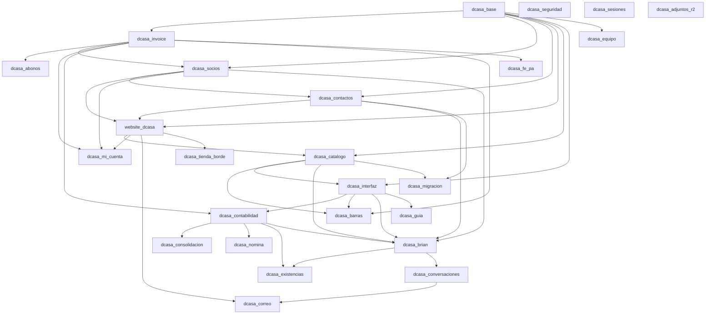

# Módulos propios (`addons/`)

Qué hace cada módulo, de qué depende, qué guarda y qué pantallas trae. Sacado de cada `__manifest__.py`, de
`models/`, de `security/` y de las vistas, en el commit de este documento (2026-10-18). Si algo de aquí no coincide con
el código, manda el código.

Reglas que valen para todos (de [`CLAUDE.md`](../CLAUDE.md)):

- `vendor/odoo` no se toca nunca: todo cambio de comportamiento se hereda desde un módulo de `addons/`.
- Prefijo `dcasa_` en módulos y en campos nuevos de modelos de Odoo (`l10n_pa_` si es de localización).
- Todos son LGPL-3, versión `19.0.x.y.z`, autor y sitio de D'CASA en el manifiesto.
- Qué ve cada rol: [PERMISOS.md](PERMISOS.md). Cómo se conectan con Cloudflare: [ARQUITECTURA.md](ARQUITECTURA.md).

## Cuáles se instalan

El contenedor instala (y actualiza en cada versión nueva) la lista `ODOO_MODULES` de
[`docker/entrypoint.sh`](../docker/entrypoint.sh) (línea 176). Son **todos menos `dcasa_fe_pa`**, que no está en la lista y
por eso **no se instala en producción**. `make init` (el [`Makefile`](../Makefile)) instala una lista más corta: le faltan
también `dcasa_seguridad`, `dcasa_sesiones` y `dcasa_adjuntos_r2`. `scripts/test.sh` sin argumentos prueba **todos** los
de `addons/`, también `dcasa_fe_pa`.

## Resumen

«Brian» = cuántas herramientas del asistente del panel declara el módulo (`@herramienta`). «Apagado» = viene instalado
pero sin efecto hasta que alguien lo enciende.

| Módulo | Para qué | Depende de (propios) | Brian | ¿Apagado de fábrica? | Documento |
|---|---|---|---|---|---|
| `dcasa_base` | Empresa, Panamá (ITBMS, RUC con DV), roles Vendedora y Gerencia, reglas contables, tope de descuento | — | — | No | [PERMISOS.md](PERMISOS.md) |
| `dcasa_invoice` | Factura, cotización, compra y entrega con la marca; «Imprimir documentos» | base | — | No | [auditoria/ronda7/factura.md](auditoria/ronda7/factura.md) |
| `dcasa_abonos` | Hoja «Condiciones de abono» (copia cliente y copia empresa) | invoice | — | No | — |
| `dcasa_socios` | Programa de puntos y referidos, y programa de vendedores | base, invoice | — (las suyas están en `dcasa_brian`) | Socios no; canje de externos y efectivo **sí** | [SOCIOS.md](SOCIOS.md) · [VENDEDORES.md](VENDEDORES.md) |
| `dcasa_mi_cuenta` | Panel del cliente en `/mi-cuenta` | website_dcasa, socios, invoice | — | No | [SOCIOS.md › Mi cuenta](SOCIOS.md#mi-cuenta) |
| `website_dcasa` | Sitio y tienda, editados desde el código | base, socios, contactos | — | El constructor visual de Odoo, **sí** (a propósito) | [OPERACION.md](OPERACION.md) · [REDISENO.md](REDISENO.md) |
| `dcasa_catalogo` | Carga el catálogo (Excel + fotos) y el código público del producto | base, website_dcasa | — | No | [CATALOGO.md](CATALOGO.md) |
| `dcasa_interfaz` | Inicio por rol, Estadísticas, íconos, sin avisos de Enterprise | base, catalogo | — | No | [auditoria/ronda6/panel.md](auditoria/ronda6/panel.md) |
| `dcasa_contabilidad` | Reportes contables, bancos, conciliación, cierre de mes, presupuestos, cheques | base, invoice, interfaz | — | No | [CONTABILIDAD.md](CONTABILIDAD.md) |
| `dcasa_consolidacion` | Estados financieros de varias empresas en uno | contabilidad | — | No | [CONSOLIDACION.md](CONSOLIDACION.md) |
| `dcasa_nomina` | Planilla de Panamá, décimo, vacaciones, liquidación, reembolsos, adelantos y préstamos, comprobante de pago, bono por meta | base, contabilidad | (3 en `dcasa_brian`) | El correo del comprobante sigue el interruptor de `dcasa_correo` | [NOMINA.md](NOMINA.md) |
| `dcasa_contactos` | Una persona, una ficha (celular, correo y RUC no se repiten) | base, socios | — | No | [CONTACTOS.md](CONTACTOS.md) |
| `dcasa_equipo` | Ícono y visibilidad del menú Empleados | base | — | No | [EQUIPO.md](EQUIPO.md) |
| `dcasa_migracion` | Carga única desde el sistema anterior | base, contactos, catalogo | — | No (solo administradores) | [MIGRACION.md](MIGRACION.md) |
| `dcasa_barras` | Escáner de códigos de barras y etiquetas | catalogo, interfaz, invoice | — | No | [BARRAS.md](BARRAS.md) |
| `dcasa_existencias` | Mermas, daños, muestras y regalos (F6); bitácora de bodega; alertas diarias por Telegram; el hueco del Inventario físico | base, brian, contabilidad, interfaz | (3 en `dcasa_brian`) | Alertas **sí** (y sin umbrales); cuentas de mermas vacías | [EXISTENCIAS.md](EXISTENCIAS.md) |
| `dcasa_brian` | Brian, el asistente del panel (chat, Telegram, MCP) | interfaz, contabilidad, catalogo, socios, contactos | 70 | Sin `BRIAN_API_KEY` no contesta (el despliegue la exige) | [BRIAN.md](BRIAN.md) |
| `dcasa_guia` | «¿Qué necesitas hacer hoy?»: atajos en palabras sencillas | interfaz | — | No | [GUIA.md](GUIA.md) |
| `dcasa_conversaciones` | Bandeja de conversaciones con clientes, CRM automático y la API de Juan | brian, catalogo, interfaz, socios, contactos | 2 (+13 de Juan) | Sin los tokens de Juan, la API responde 503 | [JUAN_ODOO.md](JUAN_ODOO.md) · [CRM_AUTOMATICO.md](CRM_AUTOMATICO.md) |
| `dcasa_correo` | Correo a clientes por Resend (factura, abono, bienvenida) | base, invoice, socios, website_dcasa, conversaciones | 2 | **Sí**: sin `RESEND_API_KEY` y sin encenderlo en Ajustes no sale nada | [CORREO.md](CORREO.md) |
| `dcasa_fe_pa` | Factura electrónica de la DGI (preparación, PAC simulado) | base, invoice | (1 en `dcasa_brian`) | **Sí**, y además no se instala | [FACTURA_ELECTRONICA.md](FACTURA_ELECTRONICA.md) |
| `dcasa_seguridad` | Doble factor, bloqueos, accesos, puerta del equipo `/master`, Turnstile, robots.txt | — | — | La obligatoriedad y la puerta dependen de variables | [SEGURIDAD_ACCESO.md](SEGURIDAD_ACCESO.md) |
| `dcasa_sesiones` | Sesiones de Odoo en PostgreSQL y `/dcasa/salud` | — | — | No | [DESPLIEGUE.md](DESPLIEGUE.md) |
| `dcasa_tienda_borde` | Avisa al Worker qué páginas cambiaron (caché de páginas anónimas) | website_dcasa | — | La caché se enciende con `TIENDA_ESTATICA` | [`edge/CONTRATO_CONTENEDOR.md`](../edge/CONTRATO_CONTENEDOR.md) §5 |
| `dcasa_adjuntos_r2` | Guarda fotos y PDF en R2 en vez de la base | — | — | No (con credenciales de R2) | [OPERACION.md › Adjuntos en R2](OPERACION.md) |

## Cómo dependen entre sí

Solo las dependencias entre módulos propios (de cada `__manifest__.py`). Las de Odoo están en cada sección.

`dcasa_seguridad`, `dcasa_sesiones` y `dcasa_adjuntos_r2` no dependen de ningún módulo propio. `dcasa_sesiones` se carga
además como módulo de todo el servidor (`server_wide_modules = base,web,dcasa_sesiones`).

---

## `dcasa_base` — Base

- **Para qué:** la empresa (datos de `data/res_company_data.xml`, con `noupdate`: después se editan en *Ajustes ›
  Empresas*), Panamá (plan contable `l10n_pa`, ITBMS, RUC con DV, USD, zona horaria `America/Panama`, español
  `es_419`), los dos roles de la tienda y las reglas que cierran lo contable a quien solo vende.
- **Depende de (Odoo):** `contacts`, `crm`, `sale_management`, `sale_stock`, `purchase`, `stock`, `account`, `l10n_pa`.
- **Modelos:** `dcasa.humo` (prueba de humo del arranque: columnas que faltan y pantallas clave), `dcasa.mantenimiento`
  (vigilancia de disco, memoria y base; depuración y reporte mensual). Hereda `sale.order.line` (tope de descuento),
  `stock.quant` (existencias solo por Gerencia), `product.template`/`product.product` (precio y costo solo Gerencia,
  código público), `sale.order` (costo y ganancia por línea al confirmar), `res.partner`, `res.company`, `account.move`.
- **Seguridad:** `security/dcasa_roles.xml` (grupos **Vendedora** y **Gerencia**), `security/dcasa_reglas_contables.xml`
  (reglas de registro), `models/campos_contables.py` (campos con grupo de contabilidad).
- **Pantallas y menús:** *Ventas › Hoy › Ventas de hoy* y *Cobros de hoy (caja)*; *Ventas › Facturas*; *Ajustes de
  Ventas › Descuento máximo de la vendedora*. Esconde los reportes del CRM a quien no es gerente de ventas.
- **Crons:** vigilancia horaria de disco, memoria y base; depuración mensual; reporte mensual de tamaños.
- **Apagado de fábrica:** no.

## `dcasa_invoice` — Factura

- **Para qué:** el formato de los documentos con la marca: factura (sello **PAGADO**, monto en letras, Cédula/RUC con
  DV), cotización, pedido de compra, nota de entrega y «nota de entrega fácil», con su QR. «Imprimir documentos» saca
  entrega → factura del cliente → copia de la empresa. Los textos de garantía, cambios y términos se escriben una vez
  (`models/res_company.py`, `TEXTOS_INICIALES`) y después se cambian en *Ajustes › Empresas › Documentos D'CASA*.
- **Depende de (Odoo):** `account`, `sale`, `stock`, `sale_stock`, `purchase`.
- **Modelos:** `dcasa.impresion.paquete` (asistente de impresión), `dcasa.facturas.panel`, `dcasa.documento`,
  `dcasa.qr.mixin`; hereda `account.move`, `sale.order`, `purchase.order`, `stock.picking`, `res.company`.
- **Rutas web:** `/dcasa/doc/<tipo>/<referencia>` (el QR del documento) y `/dcasa/paquete.pdf`.
- **Apagado de fábrica:** no.

## `dcasa_abonos` — Condiciones de abono

- **Para qué:** la hoja «Condiciones de abono» en dos copias (COPIA CLIENTE y COPIA EMPRESA), una hoja cada una, con la
  marca de las facturas. Sale en «Imprimir documentos», marcada en el primer abono. Solo imprime: no cambia la
  contabilidad. El texto inicial está en `models/condiciones.py` (`CONDICIONES_INICIALES`) y se escribe una sola vez; se
  cambia en *Ajustes › Empresas › Documentos D'CASA* (campo `dcasa_abono_condiciones`).
- **Modelos:** el reporte `report.dcasa_abonos.report_condiciones_abono`; hereda `res.company` y el asistente de impresión.
- **Apagado de fábrica:** no.

## `dcasa_socios` — Socios D'CASA (puntos y referidos) y programa de vendedores

- **Para qué:** puntos automáticos al pagarse la factura, referidos (padrino y ahijado), premios, canjes, cumpleaños y
  la app del socio con celular + PIN en `/socios`. También el programa de vendedores (comisión por ventas pagadas, un
  solo nivel). **Ninguna cifra vive en el código:** todas salen de `data/puntos.json`.
- **Depende de (Odoo):** `sale_management`, `account`, `website_sale`.
- **Modelos:** `dcasa.movimiento` (el libro de puntos; nadie lo escribe por RPC), `dcasa.compra`, `dcasa.canje`,
  `dcasa.premio`; vendedores: `dcasa.vend.movimiento` (su libro), `dcasa.vend.comision`, `dcasa.vend.canje`,
  `dcasa.vend.reglas` (las cifras vigentes con versión y fecha), `dcasa.vend.ajustes`; asistentes de ajuste, anulación,
  compra manual, afiliar vendedor y cobrar premio. Hereda `res.partner` (PIN, código de socio, padrino).
- **Pantallas y menús:** app **Socios** (Socios, Canjes, Compras, Libro de puntos, Vendedores, Canjes de vendedores,
  Comisiones, Libro de vendedores, Historial de reglas), *Reportes* (Puntos por vendedora, Pasivo del programa, Costo y
  pasivo de vendedores) y *Configuración* (Premios, Premios para vendedores, Registrar compra a mano, Ajustes del
  programa de vendedores).
- **Rutas web:** `/socios` y sus pasos (`/socios/entrar`, `/registro`, `/pin`, `/cuenta`, `/premios`, `/canjear`,
  `/terminos`, `/salir`…), `/r/<código>` (enlace de referido), `/v/<código>` y `/socios/vendedor*` (vendedores),
  `/vendedores/terminos`.
- **Herramientas de Brian (en `dcasa_brian`):** `saldo_puntos`, `ajustar_puntos` (sensible) y seis de vendedores
  (`consultar_vendedor`, `resumen_programa_vendedores`, `afiliar_vendedor`, `suspender_vendedor`, `reactivar_vendedor`,
  `ajustar_puntos_vendedor`).
- **Crons:** vencer canjes y regalos de cumpleaños (cada hora).
- **Apagado de fábrica:** el programa de vendedores lo controla `vendedores.programaActivo` de `puntos.json` (en este
  commit está encendido); el canje de vendedores externos (`canje.externosHabilitado`) y el canje en efectivo
  (`efectivoHabilitado`) están **apagados** y el servidor los ignora aunque alguien los mande. Reglas no negociables:
  [PERMISOS.md › Socios y Vendedores](PERMISOS.md#reglas-no-negociables-de-socios-y-vendedores).

## `dcasa_mi_cuenta` — Mi cuenta (panel del cliente)

- **Para qué:** `/mi-cuenta` para el cliente: sus compras, cuánto le falta de cada abono, entregas, puntos y datos.
  Entra con celular + PIN (sesión de Socios) o con la cuenta de la tienda (usuario portal). Solo lee.
- **Depende de (Odoo):** `sale_stock`, `website_sale`.
- **Modelos:** `dcasa.mi.cuenta` (arma lo que se muestra, siempre filtrado por la ficha del cliente).
- **Rutas web:** `/mi-cuenta`, `/mi-cuenta/compras`, `/mi-cuenta/compras/<id>`, `/mi-cuenta/facturas/<id>`,
  `/mi-cuenta/puntos`, `/mi-cuenta/datos`; redirige `/socios/cuenta` y el `/my` del cliente de la tienda.
- **Apagado de fábrica:** no.

## `website_dcasa` — Sitio web y tienda

- **Para qué:** el sitio y la tienda con la marca, **mantenidos desde el código**: el constructor visual de Odoo está
  apagado a propósito (guardar con él hace una copia que deja de recibir los cambios del código; ver
  [OPERACION.md › El sitio se edita por código](OPERACION.md)). Paleta y tipografías en
  `static/src/scss/primary_variables.scss`. Páginas legales en `views/legal_templates.xml`. Apartados por la web con
  plazo (`website_dcasa.apartado_dias`), Black Weekend con ventana de fechas, reseñas, SEO y datos estructurados.
- **Depende de (Odoo):** `website_sale`.
- **Modelos:** `dcasa.imagen.variante` (fotos WebP al ancho justo); hereda `website` (número de WhatsApp
  `dcasa_whatsapp_number`, SEO), `sale.order` (apartar), `res.config.settings`.
- **Pantallas y menús:** *Ventas › Hoy › Apartados por vencer*; *Sitio web › Configuración › Ajustes* (WhatsApp de todos
  los botones y días del apartado).
- **Rutas web:** `/visitanos`, `/privacidad`, `/terminos` (y `/terms` → `/terminos`), `/whatsapp`, `/codigo/<código>`,
  `/dcasa/carrito/agregar`, `/dcasa/img/...` y la página de la campaña Black Weekend.
- **Crons:** anular los apartados de la web que nadie reclamó (diario).
- **Apagado de fábrica:** el constructor visual (`dcasa_interfaz.sitio_editable` en 0). Black Weekend solo dentro de su
  ventana (variables `DCASA_BLACK_WEEKEND*`).

## `dcasa_catalogo` — Catálogo

- **Para qué:** carga en Odoo los productos de `data/catalogo.json`, `data/fichas.json` y
  `data/inventario_anterior.csv`, con las fotos de `static/img/productos/` (los genera `scripts/importar_catalogo.py`
  desde «up media/»). El mismo producto sirve para inventario, ventas y tienda. Le da a cada producto un código público
  y la columna de stock ordenable. Existencias de prueba solo en staging (`DCASA_STOCK_PRUEBA`).
- **Ojo para otro negocio:** la carga corre al **instalar** (`post_init_hook`): con los archivos de D'CASA, la base nueva
  recibiría el catálogo de D'CASA. Ver [REPLICAR.md](REPLICAR.md) §4.
- **Depende de (Odoo):** `website_sale_stock`.
- **Modelos:** sin modelos nuevos; hereda productos y `sale.order` (cotización por WhatsApp).
- **Apagado de fábrica:** no.

## `dcasa_interfaz` — Interfaz

- **Para qué:** la cara de Odoo por dentro: **Inicio** con el tablero del día según el rol (`dcasa.tablero`), menú
  **Estadísticas** (lo más vendido, mejor margen, lo que no se mueve; Gerencia y administradores), íconos propios, la
  barra lateral, el favicon y el manifiesto web, la pantalla de login con la marca, y fuera los avisos de Enterprise
  (salen como «En desarrollo»), el recorrido guiado y OdooBot. Le quita a todos el grupo de diseñador del sitio.
- **Depende de (Odoo):** `website`, `sale_management`, `stock`, `stock_delivery`, `account`, `web_tour`, `mail_bot`.
- **Modelos:** `dcasa.tablero` (cifras del Inicio, comparar ventas), `dcasa.sitio` (vista previa móvil y el candado del
  constructor).
- **Pantallas y menús:** *Inicio*, *Estadísticas*, *Sitio web › Configuración › Vista previa móvil*; reacomoda quién ve
  *Pagos a proveedores*, *Reportes contables*, *Productos* y *Listas de precios*.
- **Apagado de fábrica:** no.

## `dcasa_contabilidad` — Contabilidad

- **Para qué:** reportes contables propios (resumen, estado de resultados, balance general, flujo de efectivo, por
  cobrar, por pagar, balance de comprobación, libro mayor, ITBMS, analítica) en pantalla, Excel y PDF; conciliación
  bancaria con importación de extractos CSV y reglas; presupuestos; cierre de mes guiado; cheques.
- **Depende de (Odoo):** `account`, `analytic`, `account_check_printing`.
- **Modelos:** `dcasa.reporte.contable`, `dcasa.conciliacion`, `dcasa.importar.extracto`, `dcasa.formato.extracto`,
  `dcasa.presupuesto` (+ línea), `dcasa.cierre.mes` (+ paso), `dcasa.atajo.fechas`.
- **Pantallas y menús:** *Contabilidad › Bancos* (Conciliación bancaria, Importar extracto, Reglas de conciliación,
  Formatos de extracto), *Reportes contables* (todos los de arriba y Presupuestos), *Cierre de mes*, y la app **Envíos**
  y «En desarrollo» (pantallas que todavía no existen).
- **Rutas web:** `/dcasa/contabilidad/excel`.
- **Herramientas de Brian (en `dcasa_brian`):** 16 (reportes, comparar periodos, antigüedad de saldos, facturas, pagos,
  conciliar, guía y cierre de mes).
- **Apagado de fábrica:** no.

## `dcasa_consolidacion` — Consolidación

- **Para qué:** estado de resultados, balance general y balance de comprobación de varias empresas del grupo en uno
  (columna por empresa, eliminaciones entre empresas y consolidado), con mapa de cuentas y PDF.
- **Modelos:** `dcasa.consolidacion` (+ línea), `dcasa.consolidacion.mapa`, `dcasa.consolidacion.motor`.
- **Pantallas y menús:** *Contabilidad › Reportes contables › Consolidación* y *Mapa de cuentas (consolidación)*.
- **Apagado de fábrica:** no (solo sirve con más de una empresa).

## `dcasa_nomina` — Nómina

- **Para qué:** fichas de colaboradores, planilla quincenal de Panamá (seguro social, seguro educativo, ISR), décimo
  tercer mes, vacaciones, prima, liquidación, reembolsos en nómina, bono por meta de ventas y su asiento contable. Las
  tasas las valida el contador (`data/nomina_data.xml`). La meta y el % del bono de D'CASA están en
  `data/meta_ventas_data.xml`.
- **Depende de (Odoo):** `hr`, `account`, `mail`.
- **Modelos:** `dcasa.nomina.planilla` (+ línea), `dcasa.nomina.parametros`, `dcasa.nomina.isr.tramo`,
  `dcasa.nomina.config`, `dcasa.nomina.vacacion`, `dcasa.nomina.liquidacion`, `dcasa.nomina.reembolso`,
  `dcasa.nomina.meta.regla`, `dcasa.nomina.meta.bono`.
- **Seguridad:** grupo propio **Administra la nómina** (`group_nomina`), que Gerencia incluye; reglas por empresa; cada
  quien ve solo sus reembolsos.
- **Pantallas y menús:** app **Nómina** (Planillas quincenales, Décimo tercer mes, Colaboradores, Vacaciones,
  Liquidaciones, Reembolsos, Bono por meta, Configuración › Tasas y reglas, Cuentas y diario, Meta de ventas) y, para
  todo el personal, **Mis gastos por reembolsar**.
- **Crons:** poner al día el bono por meta (diario).
- **Apagado de fábrica:** no.

## `dcasa_contactos` — Contactos sin duplicados

- **Para qué:** un celular (con o sin +507), un correo y un RUC/cédula = una sola ficha. Lista de posibles duplicados con
  fusión segura (solo Gerencia, de a una persona), aviso de ficha repetida al cotizar, celular y correo obligatorios
  (con la casilla «Cliente no tiene correo electrónico»). El chat y la tienda reutilizan la ficha que ya existe.
- **Depende de (Odoo):** `hr`, `mail`, `sale_management`, `account`.
- **Modelos:** `dcasa.contacto.duplicado`; hereda `res.partner` (llaves `pa:` / `intl:`) y `sale.order`.
- **Pantallas y menús:** *Socios › Configuración › Posibles duplicados* y *Clientes sin correo o sin celular*.
- **Apagado de fábrica:** no.

## `dcasa_equipo` — Equipo

- **Para qué:** el ícono de marca de **Empleados** y quién ve ese menú (Gerencia, administradores, contabilidad y quien
  administra al personal; la vendedora no). Los datos de las personas viven solo en Odoo.
- **Depende de (Odoo):** `hr`.
- **Apagado de fábrica:** no.

## `dcasa_migracion` — Cargar datos del sistema anterior

- **Para qué:** carga única de clientes, proveedores, productos, existencias, precios de proveedor, ventas y compras
  pendientes, facturas y pagos del año, con «Revisar» (no cambia nada) antes de «Cargar». Los archivos viajan por la
  pantalla de Odoo, nunca por el repositorio (lo vigila una prueba).
- **Modelos:** `dcasa.migracion.carga`.
- **Pantallas y menús:** *Ajustes › Cargar datos del sistema anterior* (solo administradores).
- **Apagado de fábrica:** no, pero solo lo ve el administrador.

## `dcasa_existencias` — Control de existencias

- **Para qué:** mermas, daños, muestras y regalos con su código, su costo, su cuenta (la elige la contadora) y el aviso
  del 0.5 % de lo comprado; reclamo al proveedor en PDF; bitácora de bodega (antes → después, motivo y quién); alertas
  diarias por Telegram a Gerencia; menús, «Deshacer el ajuste», el desecho y los movimientos hacia «Ajuste de
  inventario» solo para Gerencia.
- **Depende de (Odoo):** `stock_account`, `purchase_stock`.
- **Modelos:** `dcasa.existencias.config`, `dcasa.bitacora.bodega`, `dcasa.merma.resumen` y `dcasa.merma.reclamo`
  (asistentes), `dcasa.existencias.alertas` (cron); campos `dcasa_*` en `stock.scrap`.
- **Pantallas y menús:** Inventario › Ajustes › Mermas, daños, muestras y regalos; Inventario › Reportes › Mermas del mes
  y Bitácora de bodega; Inventario › Configuración › Ajustes de bodega y mermas.
- **Apagado de fábrica:** las alertas (y sin umbrales); las cuentas de las mermas vienen vacías.

## `dcasa_barras` — Lector de códigos de barras

- **Para qué:** *Inventario › Escáner*: busca por código, referencia o empaque, muestra foto, precio «+ ITBMS» y
  existencias, con la cámara del celular. Gerencia cuenta el inventario, cambia el precio con rastro y asigna etiquetas
  numeradas de un rollo. *Inventario › Configuración › Códigos de barras* llena los códigos desde la referencia.
- **Depende de (Odoo):** `stock`.
- **Modelos:** `dcasa.barras`, `dcasa.barras.asignacion` (+ línea), `dcasa.barras.etiqueta` (historial).
- **Apagado de fábrica:** no.

## `dcasa_brian` — Brian, el asistente del panel

- **Para qué:** chat de IA en todas las pantallas (Ctrl + J), por Telegram y como servidor MCP, con un solo catálogo de
  herramientas. Todo corre con los permisos de quien conversa; lo sensible pide **Permitir** en una tarjeta; lo
  prohibido no tiene herramienta. Proveedores: Anthropic, OpenAI y compatibles (xAI, Groq, Together, OpenRouter,
  Ollama).
- **Depende de (Odoo):** `mail`, `purchase_stock`.
- **Modelos:** `brian.conversacion`, `brian.mensaje`, `brian.accion` (registro de auditoría, solo lectura),
  `brian.uso` (consumo y costo), `brian.importacion` (+ línea), `brian.telegram.enlace`, `brian.telegram.codigo`;
  abstractos sin superficie RPC: `brian.herramientas`, `brian.proveedores`, `brian.politica`.
- **Pantallas y menús:** app **Brian** (Conversaciones, Telegram, Importaciones de productos para Gerencia; Registro de
  acciones, Consumo de IA y Ajustes para administradores).
- **Rutas web:** `/brian/mcp` y `/brian/telegram/<secreto>` (el borde no las guarda en caché).
- **Herramientas (70):** catálogo 8, clientes 7, contabilidad 16, factura electrónica 1, generales 4, guía 1,
  importación 3, operación (compras, inventario, consumo) 9, usuarios 4, vendedores 6, ventas 11. Niveles: lectura,
  construcción, sensible. Lista viva: `grep -rn "@herramienta" addons/dcasa_brian/models`.
- **Crons:** borrar conversaciones viejas y adjuntos huérfanos (mensual).
- **Apagado de fábrica:** el tope de gasto de IA viene en 0 (sin tope) hasta que la dueña ponga la cifra.

## `dcasa_guia` — Guía del negocio

- **Para qué:** «¿Qué necesitas hacer hoy?»: atajos en palabras sencillas a lo que hay que hacer. Las entradas están en
  `data/guia.json` (toda pantalla nueva que un administrador deba encontrar se agrega ahí; regla de `CLAUDE.md`).
- **Modelos:** `dcasa.guia`, `dcasa.guia.uso` (cada quien ve solo su uso).
- **Pantallas y menús:** app **Guía**.
- **Herramientas de Brian (en `dcasa_brian`):** `buscar_en_guia`.
- **Apagado de fábrica:** no.

## `dcasa_conversaciones` — Conversaciones (la bandeja de Juan)

- **Para qué:** la bandeja de conversaciones con los clientes (WhatsApp, Telegram, Messenger, Instagram), el traspaso a
  una vendedora, el reparto, el CRM que se ajusta solo y la API privada que usa el Worker de Juan
  (`/dcasa/juan/v1/*`, solo por el service binding del borde). La base de conocimiento de Juan y sus ajustes
  (horario, canales, proveedor de IA, nombre público) viven aquí.
- **Depende de (Odoo):** `crm`, `sale_crm`, `mail`, `bus`.
- **Modelos:** `dcasa.conversacion`, `dcasa.mensaje` (nadie lo escribe por RPC), `dcasa.conversacion.etiqueta`,
  `dcasa.conversacion.lectura`, `dcasa.conocimiento`, `dcasa.pregunta_pendiente`, `dcasa.respuesta.rapida`,
  `dcasa.reparto`, `dcasa.presencia`, `dcasa.juan.ajustes`, `dcasa.juan.panel`, `dcasa.juan.cliente` (llama al Worker),
  `dcasa.juan.costo.dia`, `dcasa.telegram_borrador`.
- **Seguridad:** grupo **Juan (asistente de clientes)** (`group_juan`) para el usuario técnico `juan`, sin permisos
  internos.
- **Pantallas y menús:** app **Conversaciones** (Conversaciones, Resumen, Reparto, Bandeja, Mensajes por enviar,
  Oportunidades; para gerentes de ventas: Costos de IA, Conexiones, Preguntas sin respuesta, Conocimiento del bot,
  Configuración › Etiquetas, Respuestas rápidas, Ajustes de Juan).
- **Rutas web:** `/dcasa/juan/v1/mensaje`, `/estado`, `/config`, `/herramientas`, `/herramienta`,
  `/seguimiento/hecho`, `/escribiendo`, `/foto-perfil`, y enlaces firmados de adjuntos.
- **Herramientas:** de Brian, `oportunidades_abiertas` y `resumen_del_crm`; de Juan (prefijo `juan_`), 13: buscar y ver
  productos, categorías, reglas y saldo de Socios, horario y tienda, buscar en el conocimiento, registrar pregunta sin
  respuesta, crear oportunidad, anotar, etiquetar, pasar a una vendedora y cotizar.
- **Crons:** ajustar el CRM y pedir seguimientos (cada 15 min), reintentar envíos (cada 5 min), foto diaria del gasto
  de IA, limpiar archivos, buscar respuestas de vendedoras, «Disponible» cada mañana, huella de significado del
  conocimiento.
- **Apagado de fábrica:** sin `JUAN_ODOO_TOKEN`/`JUAN_WORKER_TOKEN` la API responde 503 y Odoo arranca igual. Canales de
  fábrica: WhatsApp QR y Telegram encendidos, WhatsApp API oficial, Messenger e Instagram apagados (`models/ajustes.py`).
  Las fichas de conocimiento «garantía» y «compra» vienen inactivas.

## `dcasa_correo` — Correo a clientes (Resend)

- **Para qué:** la factura en PDF al registrar un pago (o el abono con lo que falta), la bienvenida a clientes nuevos y
  «Enviar por correo» con la marca, por la API de Resend. El remitente y la dirección de respuesta de fábrica están en
  `models/correo.py` (líneas 34-37) y se cambian en Ajustes.
- **Depende de (Odoo):** `mail`, `account`, `sale`, `sale_management`.
- **Modelos:** `dcasa.correo` (abstracto, sin superficie RPC), `dcasa.correo.envio` (registro de envíos).
- **Pantallas y menús:** *Ventas › Configuración › Correo a clientes* (administradores) y *Correos a clientes
  (enviados)* (Gerencia y administradores).
- **Herramientas de Brian:** `enviar_factura_por_correo`, `enviar_cotizacion_por_correo`.
- **Crons:** armar pendientes (10 min) y reintentar (15 min).
- **Apagado de fábrica:** **sí**: sin `RESEND_API_KEY` no sale nada, y aun con la clave hay que encender
  `dcasa_correo.enviar_a_clientes` (y `al_pagar`) en Ajustes.

## `dcasa_fe_pa` — Factura electrónica DGI (preparación)

- **Para qué:** el terreno para la factura electrónica de la DGI: datos fiscales, documento rFE con CUFE, cola con
  reintentos y contingencia, PAC simulado. Falta elegir el PAC.
- **Depende de (Odoo):** `account`, `l10n_pa`.
- **Modelos:** `dcasa.fe.documento`, `dcasa.fe.intento`, `dcasa.fe.anular.wizard`; abstractos `dcasa.fe.pac` y
  `dcasa.fe.pac.simulado`.
- **Pantallas y menús:** *Contabilidad › Clientes › Factura electrónica (DGI)*.
- **Herramientas de Brian (en `dcasa_brian`):** `estado_factura_electronica`.
- **Crons:** cola de factura electrónica (cada 5 min; no hace nada con la FE apagada).
- **Apagado de fábrica:** **sí** (`l10n_pa_fe_activo` en falso) y **no se instala** (no está en `ODOO_MODULES`).

## `dcasa_seguridad` — Seguridad de acceso

- **Para qué:** doble factor (app de códigos y llaves de acceso), obligatoriedad por variable, bloqueo progresivo,
  registro y avisos por Telegram de inicios de sesión, sesiones de administrador con vencimiento, la página
  «Acceso del equipo» (`/master`) que trabaja con la puerta del borde, Turnstile y robots.txt para rastreadores de IA.
- **Depende de (Odoo):** `base`, `web`, `website`, `auth_totp`, `auth_totp_mail`, `auth_passkey`, `auth_timeout`,
  `website_cf_turnstile`.
- **Modelos:** `dcasa.seguridad.acceso` (Accesos al panel, 180 días).
- **Pantallas y menús:** *Ajustes › Usuarios › Accesos al panel* (administradores).
- **Rutas web:** `/master`, la de enrolar el doble factor y `/robots.txt`.
- **Crons:** purgar el registro de accesos (semanal).
- **Apagado de fábrica:** la obligatoriedad (`DCASA_2FA_OBLIGATORIO`), la puerta (`DCASA_PUERTA_*`) y Turnstile
  dependen de variables; ver [PERMISOS.md › Interruptores](PERMISOS.md#interruptores).

## `dcasa_sesiones` — Sesiones en la base

- **Para qué:** las sesiones HTTP de Odoo en PostgreSQL (tabla `dcasa_http_session`), porque el contenedor no tiene
  disco permanente: así sobreviven a reinicios y despliegues. Y la ruta de salud `GET /dcasa/salud` (`ok`, `version`,
  `base_al_dia`, `humo`), que lee el borde para `/__edge/health`.
- **Apagado de fábrica:** no.

## `dcasa_tienda_borde` — Tienda en el borde

- **Para qué:** avisa al Worker qué páginas del sitio cambiaron, para la caché del HTML de visitantes anónimos en
  Workers KV, y certifica qué página se dibujó para un anónimo (`TIENDA_FEED_TOKEN`).
- **Depende de (Odoo):** `website_sale_stock`, `sale`, `account`.
- **Modelos:** `dcasa.tienda.pendiente` (avisos por mandar).
- **Rutas web:** `/dcasa/borde/csrf`.
- **Crons:** avisar a la tienda del borde (15 min) y encender/apagar Black Weekend (horario).
- **Apagado de fábrica:** la caché la decide `TIENDA_ESTATICA` del Worker (en este commit: `off` en producción, `on` en
  staging).

## `dcasa_adjuntos_r2` — Adjuntos en R2

- **Para qué:** guarda el contenido de los adjuntos (fotos, PDF, estilos compilados) en R2, en `adjuntos/<sha1[:2]>/<sha1>`
  del bucket del entorno, en vez de la base (`ir_attachment.location = r2`; con `db` vuelve a la base, sin credenciales).
  **Nunca borra un objeto de R2 al desvincular un adjunto:** un cron lo hace a los 45 días, para que una restauración a un
  momento anterior encuentre sus archivos.
- **Modelos:** `dcasa.adjunto.r2.huerfano`.
- **Crons:** mover según `ir_attachment.location` (30 min) y recolectar objetos sin uso (diario).
- **Apagado de fábrica:** no (con las credenciales `R2_*`).
